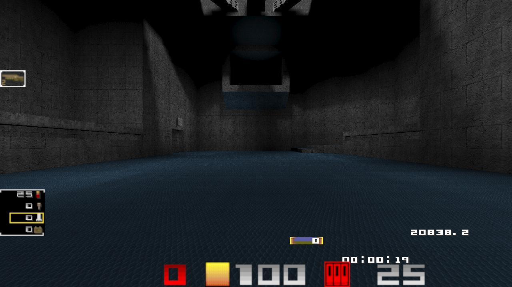

---

# 🖥️ qw-linux

> Tips for running a **QuakeWorld** client on Linux with maximum FPS.

This setup achieves **20000 FPS** at 1280×720 with FSR upscaling to 2560×1440 on `povdmm4`.



---

## 🔧 System Setup

| Component | Spec |
|-----------|------|
| **Motherboard** | MAG B650 TOMAHAWK WIFI (MS-7D75) |
| **CPU** | AMD Ryzen 7 9850X3D 8-Core |
| **RAM** | 2×16 GB DDR5 6000 MHz (0.2 ns) |
| **GPU** | PowerColor Red Devil Radeon RX 9070 XT 16 GB GDDR6 |
| **USB Controller** | ASMedia PCIe x4 v3.0 ASM3142 USB3.2 Gen2×1, 2× Type-C |
| **Mouse** | G-Wolves HSK Pro 8K |
| **Keyboard** | NuPhy Air75 HE |

---

## 💿 Software

| Component | Version |
|-----------|---------|
| **OS** | Ubuntu 26.04.1 LTS |
| **Client** | unezquake 2.1.3 |

---

## 📋 Setup Tasks

- [Peripherals](tasks/peripherals.md)
- [Kernel](tasks/kernel.md)
- [Scheduler](tasks/scheduler.md)
- [Radeon](tasks/radeon.md)

**Playing environment setup:**
- [Gamemode](tasks/gamemode.md)
- [Gamescope](tasks/gamescope.md)
- [unezquake](tasks/unezquake.md)

---

## 🚀 Run

Copy the launch script from `files/run.lavd.gamescope.gamemode.unezquake.sh` into the folder containing the unezquake client.

---

## 🧪 Tests

### 1. Test Mouse Responsiveness with `evhz`

```bash
git clone https://github.com/marcoster/evhz.git
cd evhz
./run
```

### 2. Benchmark the QW Client

In the client console, run:

```
/timedemo2 demos/fps5 77
```

Or use the `quake-benchmark` script — copy `files/quake-benchmark` into the unezquake directory:

```bash
./quake-benchmark
```

Expected output:

```
running 3 timedemos of fps5 at 77fps...

93646 frames  16.9 seconds 5538.0 fps
93646 frames  16.6 seconds 5639.0 fps
93646 frames  16.8 seconds 5562.7 fps

CPU: AMD Ryzen 7 9850X3D 8-Core Processor
GPU: AMD Radeon RX 9070 XT (radeonsi, gfx1201, ACO, DRM 3.64, 7.3.3-tkg-eevdf-llvm)
Resolution: 2560x1440@240hz [fullscreen]
Version: NA
```

---

## 📝 Notes

> All steps can be used **separately** — this repository simply gathers them all in one place.

> 🤖 **AI Disclosure:** The text formatting and editing for this documentation was assisted by **DeepSeek AI**. All technical content, configurations, and testing were performed by the author.
---
